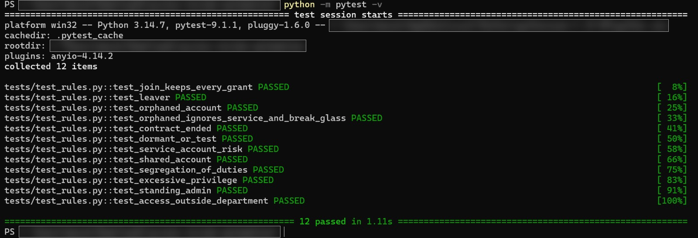
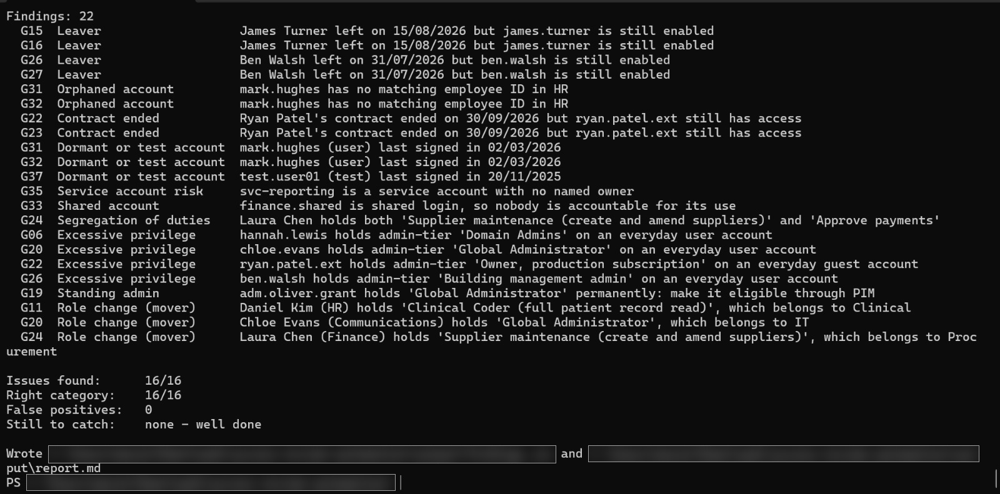

# Access Review Automation

A Python tool that automates a quarterly user access review. It joins HR records, account data and access grants, then runs rules to find risky access: leavers still enabled, orphaned accounts, contractors past their end date, dormant and test accounts, ownerless service accounts, shared logins, segregation-of-duties conflicts, excessive and standing admin privilege, and leftover access after a role change.

The sample data is a fictional health organisation, Fenwick Valley Health Services, matching the interactive Fenwick Valley Access Review lab.

## Run it

```bash
python -m pip install -r requirements.txt
python -m pytest
python -m access_review.run
```

`python -m access_review.run` prints every finding, scores the result against `data/answer_key.csv`, and writes `output/findings.csv` and `output/report.md`.

## Project layout

| Path | Purpose |
| --- | --- |
| `data/hr.csv` | HR export: the source of truth for who works here and in what role |
| `data/accounts.csv` | Active Directory / Entra ID account export |
| `data/grants.csv` | Access grants across 9 systems, with tier and owning department |
| `data/answer_key.csv` | Expected outcome per grant, used for scoring |
| `access_review/loader.py` | Loads and joins the three exports |
| `access_review/rules.py` | One function per rule |
| `access_review/run.py` | Runs the rules, scores them, writes the report |
| `tests/test_rules.py` | One test per rule |

## Framework mapping

- ISO/IEC 27001:2022 A.5.18 Access rights
- NCSC Cyber Assessment Framework, principle B2 Identity and access control
- NHS Data Security and Protection Toolkit, user access management

## Next steps

- Replace the sample CSVs with real exports from Active Directory (`Get-ADUser`, `Get-ADGroupMember`) or Entra ID (Microsoft Graph PowerShell).
- Turn the leaver and dormant-account rules into Microsoft Sentinel analytics rules.

## Results

All 16 expected risky grants found, in the right category, with no false positives. 12 automated tests pass, one or more per rule.





The same controls are enforced in Microsoft Entra ID in [entra-identity-governance-lab](https://github.com/Leomez17/entra-identity-governance-lab).
